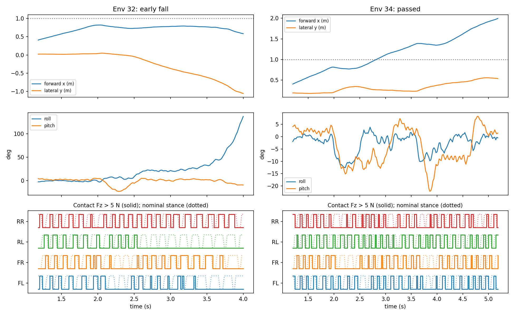

# 目标对齐后的接触诊断

权重：`1021_modal_v3_task_aligned_round1/model_4_50.pt`。
命令0.5 m/s，平地及2/4/6/8 cm各8初态，20 s上限，所有诊断干预关闭。
初态SHA与v2强化课程200更新诊断相同：
`7472995bd28e59f99ad94243deaffa3ab711fc5565b9c5fae0cdf14c334fc3c2`。

严格通过率：平地及2/4/6 cm各8/8；8 cm为3/8，3次跌倒、2次侧向越界。
原v2同组8 cm为0/8，4次跌倒。该小样本仅用于定位动作过程，
可靠性结论以三速度、32初态、多种子评估为准。

第一阶附近的描述性统计：

| 指标 | v2课程200 | 目标对齐50 |
|---|---:|---:|
| 平均频率 Hz | 9.10 | 7.10 |
| 目标支撑占空比 | 0.522 | 0.601 |
| 支撑后段缺接触 | 35.8% | 30.0% |
| 关节跟踪误差 rad | 0.153 | 0.129 |
| 参考关节速度超限占比 | 20.2% | 15.1% |
| 力矩饱和占比 | 1.95% | 1.02% |

对应名义支撑时长约57→85 ms，但实际接触仍会中断。
两套权重和控制坐标不同，不能将这些变化归因于某个单独参数。
支撑后段及空间窗口定义见`analyze_stair_trace.py`，接触采样频率50 Hz。

环境32和33中，前脚曾在第一阶上出现Fz>5 N，但后脚尚未踩上第一阶就跌倒；
环境38在更后方跌倒。环境34/36/37通过。
环境32在约2.6 s之后左后脚长期缺接触，横滚持续增长；
2.6–3.0 s该脚中心最低离起始地面约6.4 cm，而接触时脚中心约2 cm。
垂直平衡偏置约−0.9 cm，缺接触搜索伸长约1.3 cm（上限2 cm）。
这说明出现了可测量的接触恢复缺口，但不证明加大搜索量就能解决，
也不证明失去接触先于侧倾。需用同初态干预比较。

单参数诊断已完成：`--stance-extension .04`，保持同权重和所有其他参数，
初态SHA相同。结果平地及2/4 cm各8/8，6 cm为7/8，8 cm为2/8、6次跌倒。
8 cm支撑后段缺接触为32.1%（原30.0%），平地也从8.2%升至26.6%。
8 cm附近力矩饱和0.67%，IK投影仍近零；不能用饱和下降推断稳定性改善。
因此拒绝直接扩大搜索伸长，正式设置保留2 cm。
该覆盖只存在于诊断实例；报告记录覆盖值和实际值。
对照数据在`../diagnosis_modal_v3_task_aligned_50_search4cm/`。

原始证据：`report.json`、`summary.json`、`trace.npz`。
